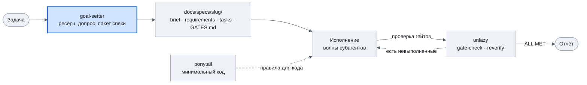

<div align="center">

# skills

**Скиллы для Claude Code: длинные автономные задачи, проверяемая готовность, минимальный код — плюс подборка для CTF и пентеста.**


[Что это](#что-это) · [Структура](#структура-репозитория) · [Скиллы](#скиллы) · [Как связаны](#как-скиллы-связаны) · [CTF](#ctf) · [Установка](#установка) · [Формат](#формат-скилла) · [Источники](#источники)

</div>

---

## Что это

Личная подборка скиллов для Claude Code. Скилл — это папка с файлом `SKILL.md`:
во frontmatter лежат имя и описание с триггерами, в теле — инструкция для агента.
Claude Code сам читает описания и подключает подходящий скилл, когда задача под него попадает.

В репозитории две части:

- **пять своих скиллов** — `goal-setter`, `unlazy`, `ponytail`, `project-context-layer`, `collab-patterns`. Они про то,
  как вести долгую задачу без человека: поставить её, довести до проверяемой готовности, не писать лишнего кода
  и не повторять поправок, которые пользователь уже делал. `collab-patterns` написан для Cursor, остальные — для Claude Code.
- **папка [`ctf/`](ctf/)** — сторонние скиллы для CTF и авторизованного пентеста. Это копии
  внешних репозиториев, каждый прочитан на предмет опасного кода перед добавлением.

## Структура репозитория

```
skills/
├── goal-setter/   постановка длинной автономной задачи: ресёрч, допрос, пакет спеки, промт запуска
├── unlazy/        проверяемые критерии готовности: гейты, дерево подзадач, Stop-хук
├── ponytail/      минимальное рабочее решение без лишних абстракций и зависимостей
├── project-context-layer/  слой контекста папки из истории сессий: правила, креды вне git, память
├── collab-patterns/        правила работы с пользователем по истории чатов Cursor
└── ctf/           сторонние скиллы для CTF и пентеста — см. ctf/README.md
    ├── ctf-recon/ … ctf-web/           9 скиллов (ctf-claude)
    ├── recon-dominator/ … api-breaker/ 6 скиллов (claude-code-pentest)
    └── hacking-skills/                 плагин: 43 скилла по web/mobile/CI-CD
```

## Скиллы

| Скилл | Для чего |
|---|---|
| [`goal-setter`](goal-setter/SKILL.md) | готовит долгую задачу для автономного агента: ресёрч, допрос, пакет спеки, промт запуска |
| [`unlazy`](unlazy/SKILL.md) | не даёт агенту сдать работу, пока не выполнены проверяемые критерии готовности |
| [`ponytail`](ponytail/SKILL.md) | заставляет писать минимальное рабочее решение без лишних абстракций и зависимостей |
| [`project-context-layer`](project-context-layer/SKILL.md) | собирает по истории сессий папки правила работы, креды в `.claude/secrets.env` вне git, типовые ошибки и общую память; хук не даёт закоммитить секреты |
| [`collab-patterns`](collab-patterns/SKILL.md) | для Cursor: разбирает историю чатов и собирает правила работы с пользователем — рабочий процесс, постановку задач, поправки, формат ответов, работу через MCP. Общие правила для User Rules или правила папки в `.cursor/rules/collab/` |

### goal-setter

Нужен, когда агент будет работать часами без тебя и всё неясное надо выяснить до старта.

- Сначала читает репозиторий, память и прошлые спеки, чтобы не спрашивать то, что можно прочитать.
- Ресёрч запускает параллельными субагентами, находки сводит в `research.md`.
- Допрашивает раундами по 2–4 вопроса и к каждому предлагает рекомендованный вариант.
- Собирает пакет связанных документов в `docs/specs/<slug>/`. Требования, критерии и задачи ссылаются друг на друга по ID.

  | Файл | Что внутри |
  |---|---|
  | `index.md` | список документов, статус пакета, промт запуска |
  | `brief.md` | зачем, цели и не-цели, бюджет, границы автономии |
  | `research.md` | вопросы, находки с источниками, что говорит против |
  | `requirements.md` | истории, критерии приёмки, нефункциональные требования, допущения |
  | `design.md` | решение, интерфейсы, альтернативы, выкатка и откат |
  | `tasks.md` | задачи, контракт и журнал исполнения |
  | `GATES.md` | критерии приёмки в виде команд-проверок `unlazy` |
  | `adr/NNNN-*.md` | записи о решениях, которые трудно откатить |

- Размер пакета подбирает под задачу. Quick: index, brief, requirements, GATES. Standard добавляет research и tasks. Full добавляет design и ADR.
- Критерии приёмки превращает в гейты `unlazy`, которые проверяются командами без человека.
- Выдаёт промт запуска. В свежей сессии ведёт исполнение волнами параллельных субагентов и перепроверяет гейты перед отчётом.

### unlazy

Нужен, когда агент склонен объявить работу готовой на середине.

- До начала работы пишет `GATES.md`: у каждого критерия есть команда `CHECK:` и ожидаемый вывод `EXPECT:`.
- `gate-check.mjs` запускает только одобренные команды. Критерий выполнен, если команда завершилась без ошибки и вывод совпал с ожидаемым.
- Большую задачу раскладывает деревом на подзадачи со своими гейтами и списком файлов. Независимые подзадачи отдаёт параллельным субагентам.
- Перед отчётом перепроверяет все гейты заново (`--reverify`), брошенные критерии перечисляет явно.
- По желанию ставится Stop-хук: он не даёт сессии завершиться, пока гейты не выполнены, и отпускает после шести остановок без прогресса.

### collab-patterns

Нужен в Cursor, когда агенту приходится каждый раз заново объяснять, как ты работаешь.

- Два режима. «Все чаты» разбирает все чаты на машине и даёт текст для User Rules: подходит, если ты часто меняешь папки, домены и стеки. «Папка» разбирает чаты одного проекта и пишет правила в `.cursor/rules/collab/*.mdc`, исключённые из git.
- `collect.py` выгружает диалоги из `~/.cursor/projects/*/agent-transcripts/`: твои реплики целиком, что агент делал между ними, где ты его прервал, что он записал во внешние системы через MCP. Похожее на токены и пароли заменяет на `[секрет]` до того, как выгрузку прочитает модель.
- Субагенты возвращают находки в одном формате с ключом паттерна, `aggregate.py` считает, в скольких диалогах паттерн повторился и стоил ли тебе итерации.
- В правила предлагается то, что повторилось в двух диалогах и больше или что ты прямо назвал правилом. Перед записью показывает кандидатов и ждёт подтверждения, отклонённое не предлагает снова без новых доказательств.
- Повторный запуск разбирает только новые чаты: состояние хранится в `.cursor/collab/` или `~/.cursor/collab/`.

### ponytail

Нужен на любой задаче с кодом, чтобы агент не переусложнял.

- Перед кодом проходит лестницу: нужно ли это вообще → есть ли уже в кодовой базе → стандартная библиотека → возможности платформы → установленная зависимость → одна строка → минимальный код.
- Баг чинит в общей функции, через которую идут все вызовы, а не в одном месте из тикета.
- Не упрощает проверку входных данных на границах доверия, обработку ошибок, безопасность и доступность интерфейса.
- Для нетривиальной логики оставляет одну запускаемую проверку.
- Уровни строгости: `lite`, `full` (по умолчанию), `ultra`.

## Как скиллы связаны

`goal-setter` ставит задачу и использует `unlazy` как движок проверок. `ponytail` работает сам по себе и задаёт, сколько кода писать.



## CTF

В папке [`ctf/`](ctf/) лежат сторонние скиллы для CTF и авторизованного пентеста —
это копии внешних репозиториев, а не скиллы этого проекта. Перед добавлением каждый
прочитан на предмет опасного кода.

15 скиллов лежат плоско (`ctf/<имя>/`) и ставятся по имени через `npx skills`; набор
`hacking-skills` оставлен плагином со своим графом.

| Источник | Что даёт | Как ставить | Лицензия |
|---|---|---|---|
| [hatrickkkk/ctf-claude](https://github.com/hatrickkkk/ctf-claude) | recon, web, pwn, privesc, docker escape, AD/ADCS (9) | `npx skills … --skill ctf-recon` | не указана |
| [Orizon-eu/claude-code-pentest](https://github.com/Orizon-eu/claude-code-pentest) | весь цикл пентеста, python-скрипты (6) | `npx skills … --skill recon-dominator` | MIT |
| [securityfortech/hacking-skills](https://github.com/securityfortech/hacking-skills) | методики web/mobile/CI-CD, OWASP (43) | `/plugin marketplace add …` | не указана |

Полная установка, итоги проверки безопасности, Kali-MCP и оговорки —
в [`ctf/README.md`](ctf/README.md). Только для авторизованного тестирования и по scope.

## Установка

Репозиторий закрытый, поэтому нужен доступ к нему и авторизация на GitHub через `gh` или SSH-ключ.

```bash
# все скиллы глобально для Claude Code
npx skills add NewaccOOO/skills -a claude-code -g

# один скилл
npx skills add NewaccOOO/skills -a claude-code -g --skill ponytail

# collab-patterns — для Cursor
npx skills add NewaccOOO/skills -a cursor -g --skill collab-patterns
```

Без `npx` скиллы можно скопировать руками:

```bash
git clone https://github.com/NewaccOOO/skills.git
cp -R skills/goal-setter skills/unlazy skills/ponytail ~/.claude/skills/
```

| Скилл | Что нужно |
|---|---|
| `goal-setter` | `unlazy` в `~/.claude/skills/unlazy`, Python 3, Node.js 16+ |
| `unlazy` | Node.js 16+ |
| `ponytail` | ничего |
| `collab-patterns` | Cursor с чатами в `~/.cursor/projects/*/agent-transcripts/`, Python 3 |

Установка скиллов из `ctf/` — в [разделе CTF](#ctf) и в [`ctf/README.md`](ctf/README.md).

## Формат скилла

Каждый скилл — папка с файлом `SKILL.md`. Frontmatter обязателен: поля `name` и `description`.
В описании перечисляют триггеры — по ним агент понимает, когда скилл нужен. В теле файла лежит
сама инструкция.

Рядом с `SKILL.md` могут лежать вспомогательные файлы, которые скилл читает по ходу работы:

- `scripts/` — исполняемые проверки и утилиты (например, `unlazy/scripts/gate-check.mjs`);
- `references/` — справочные материалы, которые подгружаются по необходимости;
- шаблоны и ассеты (например, `goal-setter/assets/templates/`).

Такую раскладку понимают и Claude Code, и CLI `npx skills`. `npx skills` ищет скиллы на глубину
до трёх уровней от корня репозитория или папки `skills/`, поэтому скилл должен лежать не глубже
`ctf/<имя>/SKILL.md`.

## Источники

Свои скиллы:

| Скилл | Откуда | Лицензия |
|---|---|---|
| `goal-setter` | написан в этом репозитории | не указана |
| `unlazy` | [Leonxlnx/unlazy](https://github.com/Leonxlnx/unlazy), добавлен раздел про параллельных субагентов | MIT |
| `ponytail` | [DietrichGebert/ponytail](https://github.com/DietrichGebert/ponytail), только сам скилл: хука плагина и дополнительных команд здесь нет | MIT |
| `collab-patterns` | написан с нуля; приёмы взяты из плагинов [cursor/plugins](https://github.com/cursor/plugins) (continual-learning, workflow-from-chats), [claude-reflect](https://github.com/BayramAnnakov/claude-reflect) и [SpecStory Lore](https://docs.specstory.com/lore) | не указана |

Скиллы из `ctf/` — сторонние, с указанием источника и лицензии в [`ctf/README.md`](ctf/README.md).
Два набора там без файла лицензии; по умолчанию все права у их авторов.
